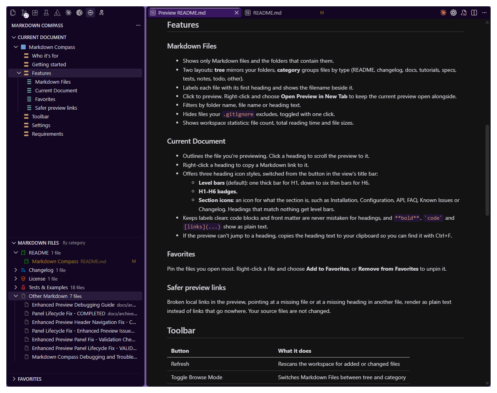

# Markdown Compass

A sidebar for the Markdown in your workspace. Markdown Compass finds every `.md` file, gathers them into one tree, and opens each in VS Code's own preview with a single click.

## Who it's for

- **Developers who document in code.** The `README.md`, `ARCHITECTURE.md` and notes scattered through a project, in one tree, without the rest of the file explorer in the way.
- **People working with AI assistants.** Plans, session summaries, work orders and research notes pile up fast. Browse, filter and preview them without opening each one to see what it covers.
- **Anyone who writes docs in Markdown** and wants them as easy to reach as the code.

## Getting started

1. Click the Markdown Compass icon in the activity bar.
2. Click a file in **Markdown Files** to open its preview.
3. Use **Current Document** to jump between that file's headings.

That's it. There is nothing to configure, and the settings below are optional.

## Features

### Markdown Files

- Shows only Markdown files and the folders that contain them.
- Two layouts: **tree** mirrors your folders, **category** groups files by type (README, changelog, docs, tutorials, specs, tests, notes, todo, other).
- Labels each file with its first heading and shows the filename beside it.
- Click to preview. Right-click and choose **Open Preview in New Tab** to keep the current preview open alongside.
- Filters by folder name, file name or heading text.
- Hides files your `.gitignore` excludes, toggled with one click.
- Shows workspace statistics: file count, total reading time and file sizes.

### Current Document

- Outlines the file you're previewing. Click a heading to scroll the preview to it.
- Right-click a heading to copy a Markdown link to it.
- Offers three heading icon styles, switched from the button in the view's title bar:
  - **Level bars** (default): one thick bar for H1, down to six thin bars for H6.
  - **H1-H6 badges.**
  - **Section icons**: an icon for what the section is, such as Installation, Configuration, API, FAQ, Known Issues or Changelog. Headings that match nothing get level bars.
- Keeps labels clean: code blocks and front matter are never mistaken for headings, and `**bold**`, `` `code` `` and `[links](...)` show as plain text.
- If the preview can't jump to a heading, copies the heading text to your clipboard so you can find it with Ctrl+F.

### Favorites

Pin the files you open most. Right-click a file and choose **Add to Favorites**, or **Remove from Favorites** to unpin it.

### Safer preview links

Broken local links in the preview, pointing at a missing file or at a missing heading in another file, render as plain text instead of links that go nowhere. Your source files are not changed.

## Toolbar

| Button | What it does |
| --- | --- |
| Refresh | Rescans the workspace for added or changed files |
| Toggle Browse Mode | Switches Markdown Files between tree and category |
| Toggle .gitignore Filtering | Shows or hides files your `.gitignore` excludes |
| Filter in Sidebar / Search Markdown Files | Both open the same filter |
| Clear Search Filter | Appears while a filter is active |
| Show Workspace Statistics | Opens the statistics summary |
| Heading icon style (Current Document) | Steps through level bars, badges and section icons |

The filter matches folder names, file names and headings (H1 to H6). It does not search body text, link URLs or non-Markdown files.

## Settings

| Setting | Default | What it controls |
| --- | --- | --- |
| `markdownCompass.browseMode` | `tree` | Markdown Files layout: `tree` or `category` |
| `markdownCompass.headingIcons` | `bars` | Current Document icons: `bars`, `levels` or `sections` |
| `markdownCompass.headingEmoji` | `strip` | `strip` removes emoji from heading labels, `keep` shows them as written |
| `markdownCompass.safeLinkSuppression.enabled` | `true` | Renders broken local links as plain text in the preview |

A few details:

- **Emoji.** Tooltips always show the original heading. With section icons on, an emoji with a known meaning, such as a warning sign or a check mark, still picks the heading's icon even when it is stripped from the label.
- **Link suppression** applies to every native Markdown preview while Markdown Compass is active. Links to headings in the same file, working links, web URLs and links to non-Markdown files are left alone.

## Requirements

VS Code 1.100 or later. Previews use VS Code's built-in Markdown preview, so there is nothing else to install.
